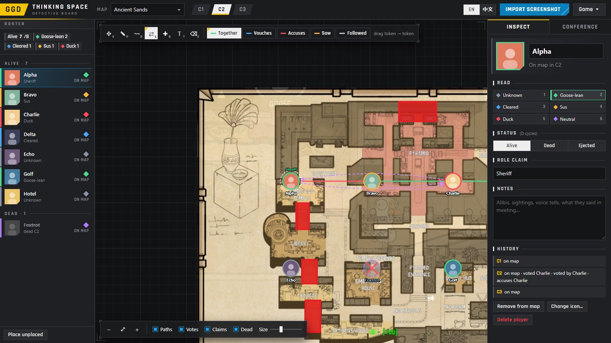

# PRTS

**中文** | [English](#english)

## 中文

一个本地运行的 **鹅鸭杀**（Goose Goose Duck）会议推理画板。粘贴一张会议界面的截图，程序会读取每位玩家的名字和头像，并标出谁已死亡。之后你可以在地图上复盘这一轮：大家当时在哪、走过的路线、不在场证明、指认、尸体位置和投票。

一切都在你自己的电脑上运行。名字识别可离线使用，不会上传任何内容。

### 运行要求

- [Node.js](https://nodejs.org/) 16 或更新版本
- 桌面浏览器：Chrome、Edge 或 Firefox

### 启动

- **Windows：** 双击 `start.bat`。
- **macOS / Linux：** 在本文件夹中运行 `node server.js`。

浏览器会打开 `http://localhost:7777`。如需使用其他端口，运行 `node server.js 8080`。

> 对局数据按地址分别保存。想看到之前的对局，请继续使用 7777 端口。

> 请通过服务器打开本程序，不要直接双击 `public/index.html`。以文件方式打开的页面无法进行名字识别。

### 使用方法

1. 会议期间截图，然后在页面上按 **Ctrl+V**，或把图片拖到页面上。中文和英文名字都能识别，聊天框打开或关闭都可以。
2. 检查识别出的名字，然后点击 **开始新对局**。
3. 把玩家从列表拖到地图上他们被看到的位置。
4. 下一次会议时，导入该次会议的截图并选择 **新会议**。每场会议都有独立的空白画板，并保留自己的截图。用 C1、C2… 标签或 `[` `]` 键切换会议。

#### 工具

| 按键 | 工具 |
|------|------|
| `V` | 移动 / 选择 |
| `R` | 路线：沿玩家走过的路线拖动 |
| `G` | 同时播放 / 暂停所有人的路线 |
| `L` | 关联两名玩家（同行、担保、指认、看见、跟随、击杀） |
| `B` | 尸体或事件标记 |
| `N` | 在地图和关系网之间切换 |
| `P` | 画笔 |
| `T` | 文字备注 |
| `E` | 橡皮擦 |
| `1`–`6` | 标记选中的玩家：未知、偏鹅、已洗白、可疑、鸭、中立 |
| `D` | 循环切换 存活 / 死亡 / 被投出 |
| `F` | 让地图（或关系网）适应屏幕 |
| `Ctrl+Z` / `Ctrl+Y` | 撤销 / 重做 |

按住 **空格** 拖动或按住鼠标中键拖动来平移，滚轮缩放。

其他功能：
- **关系网：** 所有人排成一圈，显示本场会议的关系；玩家在地图上挤在一起时也能看清
- **得票：** 每场会议中每位玩家（以及弃票）获得的票数，以角标显示在头像上
- **事件标记：** 发生了什么、什么时候（前期 / 中期 / 后期或某个 30 秒区间）以及涉及哪些玩家，在「会议」标签页中以时间线列出
- 玩家列表中的 存活 / 死亡 / 被投出 快捷按钮
- 每位玩家的身份声明和备注
- 自定义地图图片（地图菜单 → 上传）
- 把画板导出为 PNG
- 以 `.json` 保存和载入整局对局
- **EN / 中文** 语言切换

#### 框和卡片对不齐时

导入窗口中有 **校准** 滑块。如果你的截图不是普通的 16:9 全屏截图，可以用它们调整。程序会自动判断聊天框是否打开；判断错误时，可在 **布局** 中手动选择。

### 你的数据

对局保存在这台电脑浏览器的本地存储中。从 GGD Thinking Space 1.0.x 升级后数据仍会保留，只要在同一浏览器中打开同一地址（`http://localhost:7777`）。如需备份或迁移到另一台电脑，请使用 **对局 → 保存对局（.json）**；文件中包含各场会议的截图。

### 致谢

- 非官方粉丝工具，与鹅鸭杀的开发商无关，也未获其认可。
- PRTS 这个名字和界面风格是向《明日方舟》致敬的粉丝作品。本工具与鹰角网络（Hypergryph）或悠星（Yostar）无关，也未获其认可。
- 内置地图图片来自社区 Steam 指南 <https://steamcommunity.com/sharedfiles/filedetails/?id=2620700282>。
- 名字识别使用 [tesseract.js](https://github.com/naptha/tesseract.js) 及其核心、英文和简体中文语言数据，均采用 Apache License 2.0。详见 `public/vendor/LICENSES.md`。
- 界面字体为 Indian Type Foundry 的 [Rajdhani](https://fonts.google.com/specimen/Rajdhani)，采用 SIL Open Font License 1.1。详见 `public/fonts/OFL.txt`。

各版本的改动见 `CHANGELOG.md`。

---

## English

[中文](#中文) | **English**

A local detective board for **Goose Goose Duck** (鹅鸭杀) meetings. Paste a screenshot of the meeting screen. The app reads every player's name and icon and marks who is dead. You then work the round out on the map: where people were, the routes they walked, alibis, accusations, body locations and votes.

Everything runs on your own computer. Name reading works offline, and nothing is uploaded anywhere.

### Requirements

- [Node.js](https://nodejs.org/) 16 or newer
- A desktop browser: Chrome, Edge or Firefox

### Start

- **Windows:** double-click `start.bat`.
- **macOS / Linux:** run `node server.js` in this folder.

Your browser opens at `http://localhost:7777`. To use another port, run `node server.js 8080`.

> Your games are stored per address. Keep using port 7777 if you want to see games you made earlier.

> Open the app through the server, not by double-clicking `public/index.html`. Name reading can't run on a page opened as a file.

### How to use

1. During a meeting, take a screenshot and press **Ctrl+V** on the page, or drop the image onto it. Chinese and English names are both read, with the chat panel open or closed.
2. Check the names that were read, then click **Start new game**.
3. Drag players from the list onto the map where they were seen.
4. At the next meeting, import that meeting's screenshot and choose **New conference**. Each conference gets its own clean board and keeps its screenshot. Switch between conferences with the C1, C2… tabs or the `[` `]` keys.

#### Tools

| Key | Tool |
|-----|------|
| `V` | Move / select |
| `R` | Path: drag a player along the route they walked |
| `G` | Play / pause everyone's paths at the same time |
| `L` | Link two players (Together, Vouches, Accuses, Saw, Followed, Killed) |
| `B` | Body or event pin |
| `N` | Switch between the map and the relationship network |
| `P` | Pen |
| `T` | Text note |
| `E` | Eraser |
| `1`–`6` | Mark the selected player: Unknown, Goose-lean, Cleared, Sus, Duck, Neutral |
| `D` | Cycle Alive / Dead / Ejected |
| `F` | Fit the map (or the network) to the screen |
| `Ctrl+Z` / `Ctrl+Y` | Undo / redo |

Use **Space**+drag or middle-drag to pan, and the mouse wheel to zoom.

Other features:
- **Relationship network:** everyone on a ring with this conference's relations, readable even when players were bunched up on the map
- **Votes received:** how many votes each player (and Skip) got in each conference, shown as a badge on the tokens
- **Event pins:** what happened, when (early / mid / late or a 30-second span) and who was involved, listed as a timeline in the Conference tab
- quick alive / dead / ejected buttons in the player list
- per-player role claims and notes
- custom map images (map menu → Upload)
- PNG export of the board
- saving and loading whole games as `.json`
- an **EN / 中文** language switch

#### If the boxes don't line up with the cards

The import window has **Calibration** sliders. Use them if your screenshot isn't a plain 16:9 full-screen capture. Whether the chat panel is open is detected automatically; if it gets that wrong, pick it under **Layout**.

### Your data

Games are kept in your browser's local storage on this computer. Upgrading from GGD Thinking Space 1.0.x keeps them, as long as you open the same address (`http://localhost:7777`) in the same browser. To back one up or move it to another machine, use **Game → Save game (.json)**; it includes the conference screenshots.

### Credits

- Unofficial fan tool. It is not affiliated with or endorsed by the makers of Goose Goose Duck.
- The PRTS name and the interface style are a fan tribute to *Arknights*. This tool is not affiliated with or endorsed by Hypergryph or Yostar.
- The built-in map images come from the community Steam guide <https://steamcommunity.com/sharedfiles/filedetails/?id=2620700282>.
- Name reading uses [tesseract.js](https://github.com/naptha/tesseract.js) and its core, English and Simplified Chinese language data, all under the Apache License 2.0. See `public/vendor/LICENSES.md`.
- The interface font is [Rajdhani](https://fonts.google.com/specimen/Rajdhani) by Indian Type Foundry, under the SIL Open Font License 1.1. See `public/fonts/OFL.txt`.

See `CHANGELOG.md` for what changed in each version.
